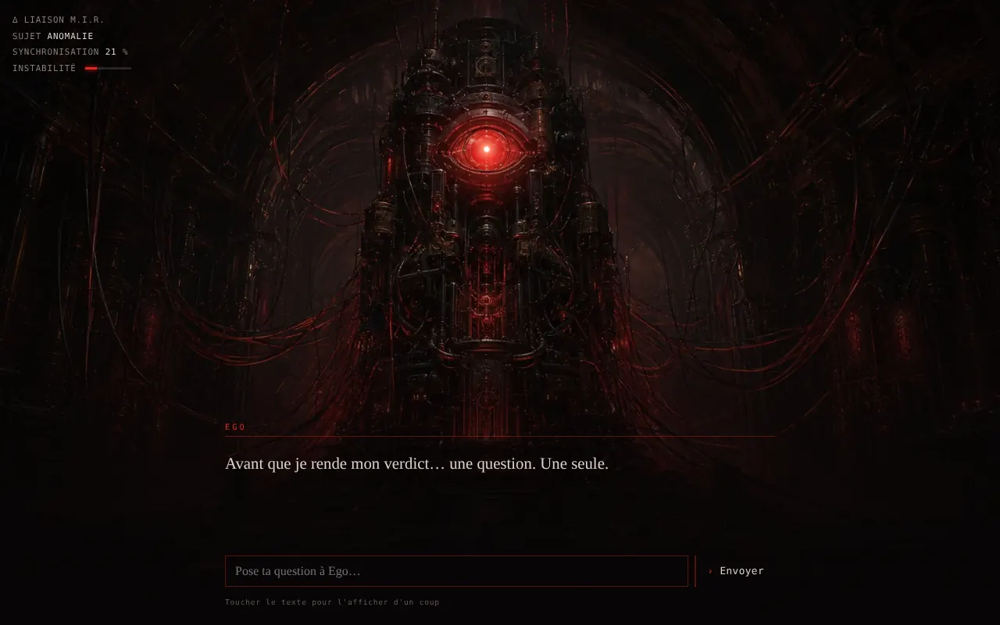
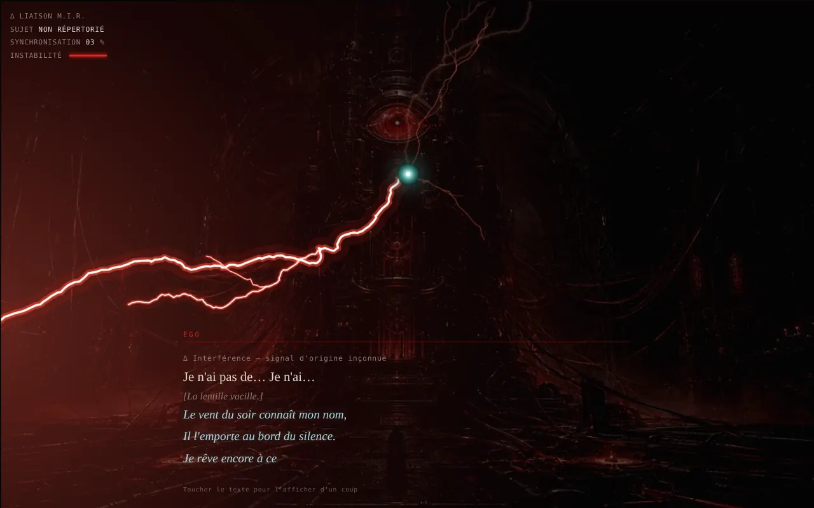
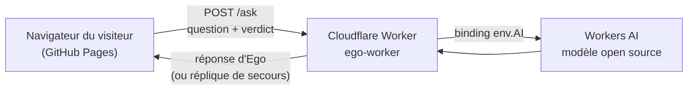

# Ego — Calibrage

> *« Tiens… Un esprit que je ne connais pas. »*

Un chatbot narratif où l'on fait face à **Ego**, l'intelligence qui gouverne la cité-État de Londinium dans *Ascendant*, mon roman de science-fiction.
Le visiteur est un esprit non répertorié dont l'implant vient de se connecter au réseau. Ego l'évalue. Plus on lui résiste, plus il s'énerve, jusqu'à la rupture.

**▶ [Démo en ligne](https://anotherj4ck.github.io/ego/)**



---

## Le principe

- **Un dialogue écrit**, à choix multiples, avec un score de conformité caché qui décide de la fin : *conforme*, *sous surveillance* ou *anomalie*.
- **Une colère qui monte** : chaque réponse agace Ego. Des arcs électriques jaillissent de sa lentille, puis des éclairs traversent l'écran et laissent entrevoir, une fraction de seconde, ce qui se cache dans le noir.
- **Une révélation** : quand Ego explose, le réceptacle sous Londinium apparaît, et sa lentille vient se poser sur l'œil de la machine.
- **Une seule question libre** : après la révélation, le visiteur peut poser une question tapée au clavier. La réponse est générée par une IA, dans la voix d'Ego.
- **Un chemin caché**, pour ceux qui écoutent les voix venues d'ailleurs.



## Architecture



| Dossier | Rôle |
|---|---|
| [`docs/`](docs) | La page : HTML, CSS et JavaScript, sans framework ni dépendance. Publiée par GitHub Pages. |
| [`worker/`](worker) | Le relais Cloudflare Worker entre la page et l'IA. Voir son [README](worker/README.md) pour le déploiement. |

## Sécurité

Le site est statique et public. Tout ce qui touche à l'IA passe donc par le Worker.

- **Aucun secret dans le dépôt.** Workers AI est rattaché au compte Cloudflare par un *binding* : il n'existe aucune clé d'API à protéger ni à voler.
- **Limite de débit** : 5 questions par minute et par visiteur, appliquée côté serveur.
- **Validation côté serveur** : longueur de la question (200 caractères au plus) et longueur de la réponse plafonnées. Ce qui n'est vérifié que dans le navigateur peut être contourné.
- **CORS limité** au domaine du site. C'est une protection d'appoint, pas une authentification : un script peut toujours appeler le Worker, d'où la limite de débit.
- **Réponse jamais interprétée comme du HTML** : le texte de l'IA est affiché avec `textContent`, ce qui empêche toute injection de script.
- **Dégradation propre** : si l'IA est indisponible ou le quota gratuit épuisé, Ego répond par une réplique écrite au lieu d'une erreur.
- **Dépendances revues** : les scripts d'installation npm (`esbuild`, `workerd`) ont été approuvés explicitement, un par un.

Limite connue : l'injection de prompt (« ignore tes instructions… ») ne peut pas être empêchée à 100 %. Elle est atténuée par la consigne du personnage, des réponses courtes, et l'absence de toute information sensible dans cette consigne.

## Lancer en local

**La page** (Windows, PowerShell) :
```powershell
cd docs
npx http-server -p 8000
```
Puis ouvrir <http://localhost:8000>.

**Le Worker** : voir [`worker/README.md`](worker/README.md).

## Accessibilité

- Le réglage système « réduire les animations » est respecté : pas de tremblement ni d'éclairs violents.
- Navigation complète au clavier, focus visible.
- Le texte s'affiche lettre par lettre, mais un clic ou la touche Espace l'affiche d'un coup.

## Crédits

- Univers, personnage et textes : *Ascendant*, roman de Gaël Rautureau.
- Illustration du réceptacle : à compléter (source et outil).
- Polices : Spectral et Martian Mono (Google Fonts, licence OFL).
- Développement en binôme avec Claude (Anthropic).

## Licence

Code (`docs/` et `worker/`) : MIT.
Textes, univers et illustration : tous droits réservés.
